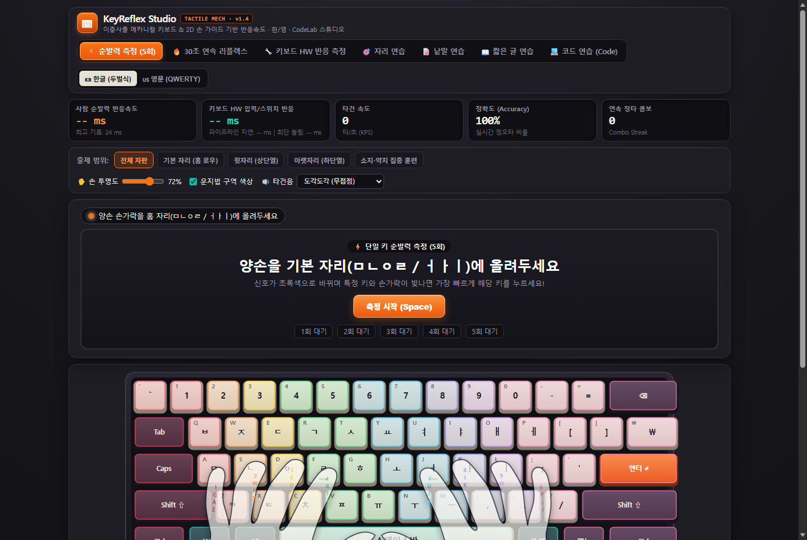
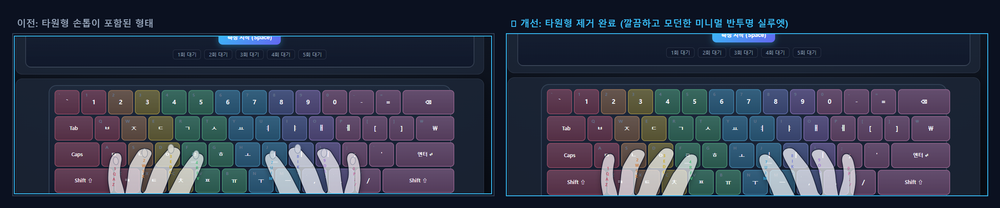
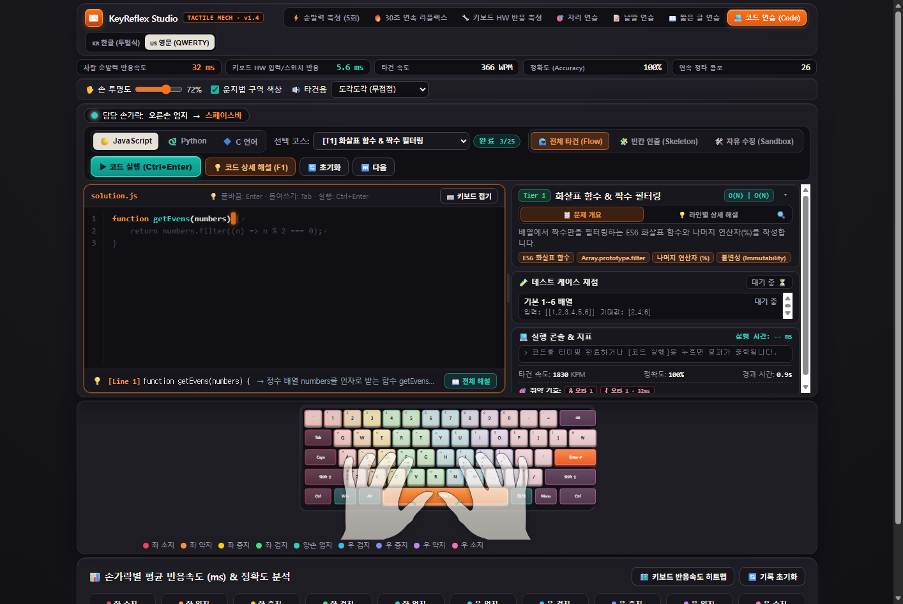
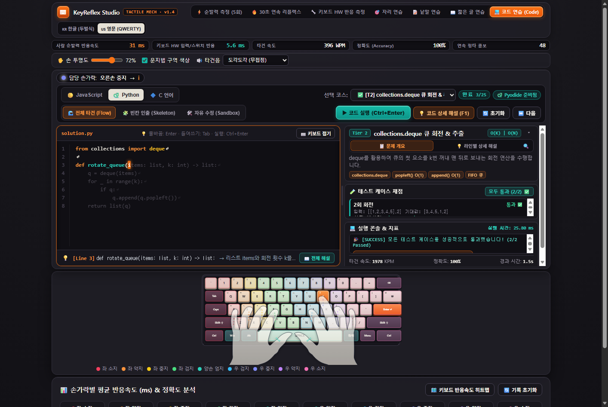
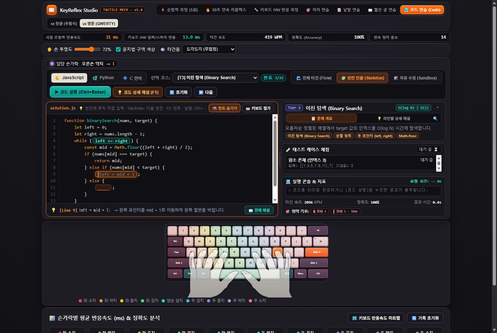
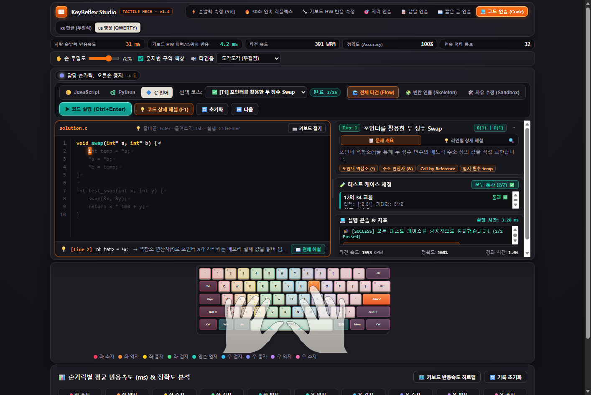
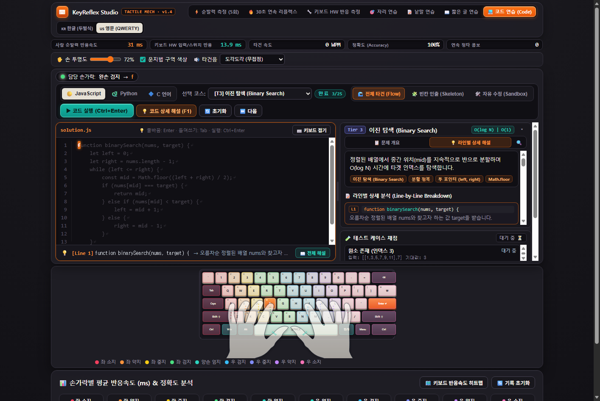
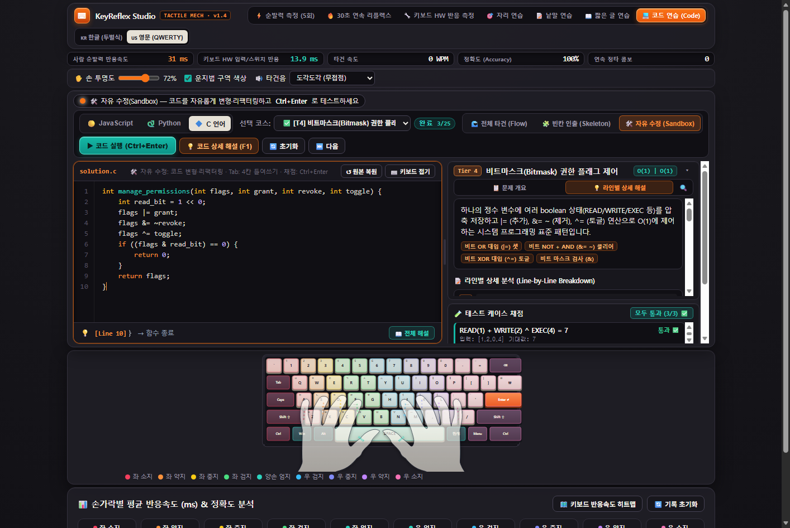
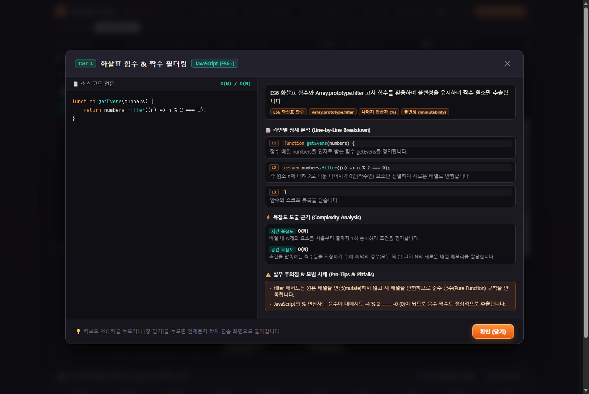

# ⌨️ KeyReflex Studio (키리플렉스 스튜디오)

> **인체공학 2D 벡터 손 가이드 기반 키보드 반응속도 측정 & 한/영 타자 연습 스튜디오**  
> Ergonomic 2D Vector Hand Guide Typing Reflex & Latency Training Studio

<div align="center">

[](LICENSE)
[](#)
[](https://github.com/ManofKimchi08/keyreflex-studio/releases)
[](#)
[](#)



</div>

---

## 🌟 주요 특징 (Key Features)

### 1. ⌨️ Tactile Mech Studio & 2D 벡터 손 가이드 (`v1.4.0` UI/UX 전면 개편)
- **3D 이중사출(Double-Shot) PBT 키캡 & 아노다이징 섀시**: 웜 매트 차콜(`#151419`) 스튜디오 섀시 위에 오프화이트 알파열, 다크 차콜 모디파이어, 엠버 오렌지(`#F97316`) 엔터 액센트 및 리세스 스위치 플레이트/육각 나사를 입체 SVG로 구현.
- **리세스드 OLED 계기판 UI & 4-Tier 컬러 위계**: 고대비 OLED 지표 카드와 Tier 1(Teal) · Tier 2(Blue) · Tier 3(Purple) · Tier 4(Amber) 난이도 시각 위계 적용.
- **자연스러운 2D 벡터 캐노니컬 손 가이드**: 베지에 곡선과 이징 역운동학(IK) 뻗음 애니메이션을 유지하며, 자모 라벨(`ㅁㄴㅇㄹ / ㅓㅏㅣ;`), 투명도 슬라이더(0~100%), 손가락별 컬러 구역 힌트 제공.

<div align="center">

</div>

---

### 2. ⚡ 사람 순발력 & 키보드 하드웨어 반응속도 정밀 측정
- **사람 순발력 반응속도 (Reaction Time)**: 신호 점등 순간부터 첫 타건까지의 반응 시간(ms)을 5회 측정하여 평균/최고 기록 산출.
- **키보드 하드웨어/스위치 반응속도 (HW Latency)**: 브라우저 입력 파이프라인 지연 및 스위치 물리 접점 지연, 키 홀드 체공 시간(Dwell Time) 실시간 정밀 트래킹.
- **10개 손가락별 반응속도 & 정확도 분석**: 좌/우 소지, 약지, 중지, 검지, 엄지별 평균 반응속도(ms) 및 정확도 리포트 실시간 제공.
- **키보드 반응속도 히트맵 (Heatmap)**: 키별 속도 분포를 시각화하여 취약 키(Slow Keys) 즉시 파악.

---

### 3. 💻 KeyReflex CodeLab: 3대 언어(JavaScript, Python, C) 실시간 실행형 타자 & 알고리즘 마스터리
단순한 텍스트 입력을 넘어 **실제 동작하는 프로그래밍 언어의 구문 감각, 100대 실전 알고리즘 템플릿, 그리고 브라우저 내 즉시 실행 및 테스트 케이스 자동 채점**을 하나로 통합한 인터랙티브 코드 훈련 환경입니다.

<div align="center">

</div>

- **Tri-Engine 인브라우저 샌드박스 (Zero Configuration)**:
  - **🟡 JavaScript (ES6+)**: Function 클로저 샌드박스 및 콘솔 가로채기로 즉시 채점
  - **🐍 Python 3**: Pyodide WebAssembly(WASM) 기반 완전한 인브라우저 파이썬 인터프리터 구동
  - **🔷 C 언어**: 브라우저 내장 경량 C99 가상머신으로 포인터 연산(`*a = *b`), 배열 순회, 문자열 조작 즉시 실행
- **듀얼 타건 훈련 시스템 (Dual Practice Mode)**:
  - **🌊 전체 타건 (Flow Mode)**: 실제 IDE와 동일하게 줄바꿈(Enter) 및 들여쓰기(Tab / 4칸 공백 스킵)를 지원하며 구문 구조 전체를 손가락 근육 기억에 각인
  - **🧩 빈칸 인출 (Skeleton Mode)**: 핵심 조건문이나 알고리즘 로직을 `____` 빈칸으로 처리하여 머릿속에서 직접 논리를 인출해 타이핑
  - **🛠️ 자유 수정 (Sandbox Mode)**: Flow/Skeleton 완료 후(또는 언제든) 코드를 자유롭게 변형·리팩터링(`Tab` 4칸 들여쓰기 · `원본 복원`)하고 즉시 재채점
  - **🐍 Pyodide 상태 배지 & 🎯 취약 코딩 기호 Top 5**: Python WASM 런타임 상태 실시간 표시 및 잦은 오타·지연 기호(`{ } [ ] ; = & |`) 자동 추적
- **실시간 테스트 케이스 자동 채점 (`Ctrl + Enter`)**:
  - 작성된 코드를 즉시 실행하여 여러 개의 테스트 케이스(Input / Expected)를 대조하고 일치 여부를 실시간 검증
  - 실행 시간(ms), 타건 속도(KPM), 정확도 종합 리포트 및 상세 콘솔 로그 제공
- **오프라인 시맨틱 구문 강조 & 확장 스플릿 에디터 (`v1.4.0`)**:
  - **🎨 전 모드 구문 강조 (Semantic Highlighting)**: 외부 CDN 없이 동작하는 자체 토크나이저로 Flow(미타건 반투명 · 완료 고대비), Skeleton, Sandbox(실시간 백드롭 동기화), 라인별 해설, F1 모달 전체에 키워드·타입·함수·문자열 컬러 적용
  - **📐 드래그 스플릿 리사이저 & 1-Line OLED 바**: 에디터/해설 비율을 자유롭게 드래그 조절(더블클릭 58% 초기화 · `localStorage` 영구 저장), 슬림 OLED 텔레메트리 바로 에디터 가용 높이 확대(한 화면 내 키보드 동시 표시), 우측 문제 개요 + 테스트 + 콘솔 + 취약 기호 동시 가시성 및 접기 토글 지원
- **4-Tier 체계적 프로그래밍 커리큘럼 (총 25개 실습 문제: JS 8 · Python 9 · C 8)**:
  - **Tier 1 (문법 & 연산자)**: 화살표 함수, 구조분해할당, 리스트 컴프리헨션, 포인터 스왑
  - **Tier 2 (자료구조)**: 큐/덱(Deque), 스택 괄호 검사, 해시맵/딕셔너리 빈도수, 포인터 문자열 회문·길이, 배열 누적합
  - **Tier 3 (실전 알고리즘)**: 이진 탐색(Binary Search), 투 썸(Two Sum), 팰린드롬, DP 피보나치, 배열 제자리 역순
  - **Tier 4 (실무 & 시스템 패턴)**: 디바운스(Debounce), O(1) LRU 캐시, `@memoize` 클로저 데코레이터, API Rate Limiter, C 비트마스크 권한·원형 버퍼(Ring Buffer)
- **💡 라인별 코드 상세 해설 & 핵심 원리 (Deep-Dive Explanation)**:
  - **라인별 정밀 분석**: 코드의 각 줄이 수행하는 역할, 문법적 의미, 함수 반환값 해설 제공
  - **실시간 라인 힌트 바**: 타이핑 중인 현재 라인 번호와 코드의 상세 해설이 에디터 하단에 실시간으로 연동되어 "내가 지금 치는 코드가 무엇을 하는지" 직관적으로 이해
  - **복잡도 도출 근거 (Complexity Analysis)**: 시간/공간 복잡도의 구조적 이유 서술
  - **실무 꿀팁 & 주의사항 (Pro-Tips & Pitfalls)**: 정수 오버플로우 방지, 널 종단 문자, 얕은 복사/클로저 상태 관리 등 주의점 제시
  - **전체 해설 모달 다이얼로그 (`단축키: F1`)**: 소스 코드 전문과 라인별 해설, 핵심 개념 칩을 전체 화면에서 정독 가능

<div align="center">

| 🐍 Python (Pyodide WASM) & C99 포인터 VM | 🧩 빈칸 인출 모드 (Skeleton + F2 힌트) |
| :---: | :---: |
|  |  |
| **🔷 C99 포인터 실행 & 테스트 검증** | **💡 라인별 상세 해설 탭 (`& F1 전체 모달`)** |
|  |  |
| **🛠️ 자유 수정 Sandbox (`Tab` 4칸 & C99 비트마스크)** | **📖 전체 해설 & 알고리즘 원리 모달 (`F1`)** |
|  |  |

</div>

<div align="center">

</div>

---

### 4. 🎯 체계적인 7가지 연습 모드
1. **⚡ 순발력 측정 (5회)**: 무작위 점등 키를 가장 빠른 반응속도로 타건하는 정밀 리플렉스 테스트.
2. **🔥 30초 연속 리플렉스**: 30초 동안 콤보를 유지하며 최고 반응속도와 정타율을 측정하는 챌린지.
3. **🔧 키보드 HW 반응 측정**: 스위치 작동점 및 소프트웨어 인풋 랙을 심층 분석하는 하드웨어 벤치마크.
4. **🎯 자리 연습**: 홈 로우(기본자리), 윗자리(상단열), 아랫자리(하단열), 소지·약지 집중 훈련 선택 연습.
5. **📝 낱말 연습**: 개발자 필수 영단어, 일상 빈출 영단어 등 테마별 단어 타자 연습.
6. **📜 짧은 글 연습**: 소나기, 메밀꽃 필 무렵, 윤동주 시 등 한국 대표 문학 명작 타이핑.
7. **💻 코드 연습 (CodeLab)**: JavaScript, Python, C 3대 언어 알고리즘 템플릿 실시간 타자(Flow / 빈칸 Skeleton / 자유 수정 Sandbox) 및 자동 채점.

---

### 5. 🔊 실감나는 기계식 / 무접점 타건음 피드백
- **Web Audio API 합성 사운드 엔진**: 외부 음원 파일 의존 없이 웹 브라우저 네이티브 사운드로 즉각 반응.
- **타건음 프리셋**:
  - 묵직한 도각도각 (무접점 Thock)
  - 쫀득한 2단 걸림 (갈축 Tactile)
  - 정숙하고 부드러운 (적축 Linear)
  - 경쾌한 찰칵 (청축 Clicky)
  - 무음 모드

---

### 6. 💻 원클릭 무설치 독립 데스크톱 앱 (`KeyReflex-Studio.exe`)
- **단일 실행 파일 (Single Executable)**: 별도 설치나 Python, Node.js 환경 없이 더블 클릭 한 번으로 실행.
- **네이티브 데스크톱 앱 창 모드**: 브라우저 주소창이나 탭 없이 깔끔한 전용 윈도우 창으로 실행.
- **핵심 기능 오프라인 작동**: 타자 연습·반응속도·JavaScript·C99 모드는 네트워크 없이 로컬에서 100% 즉시 실행 (Python 모드는 Pyodide WASM 로드를 위해 최초 실행 시 네트워크 필요).

---

## 🚀 빠른 시작 (Quick Start)

### 방법 1. 원클릭 실행 파일 (권장)
1. [GitHub Releases](https://github.com/ManofKimchi08/keyreflex-studio/releases)에서 `KeyReflex-Studio.exe`를 다운로드합니다.
2. 다운로드한 `KeyReflex-Studio.exe`를 더블 클릭하여 즉시 실행합니다.

### 방법 2. 웹 브라우저에서 바로 실행
1. 저장소를 클론하거나 ZIP으로 다운로드합니다:
   ```bash
   git clone https://github.com/ManofKimchi08/keyreflex-studio.git
   ```
2. `index.html` 파일을 더블 클릭하여 아무 최신 브라우저(Edge, Chrome, Whale, Safari 등)에서 엽니다.

---

## 📂 프로젝트 구조 (Architecture)

```text
keyreflex-studio/
├── docs/
│   └── images/              # README 및 문서용 고해상도 스크린샷
│       ├── keyreflex_main.png
│       ├── hand_guide_comparison.png
│       ├── codelab_main.png
│       ├── codelab_python.png
│       ├── codelab_c.png
│       ├── codelab_skeleton.png
│       ├── codelab_explanation_tab.png
│       ├── codelab_sandbox.png
│       └── codelab_modal_view.png
├── js/
│   ├── app.js               # 핵심 훈련 모드 상태 머신 & 통계 분석 엔진
│   ├── data.js              # ANSI 쿼티 & 두벌식 키보드 레이아웃, 한글 자모 데이터셋
│   ├── handRenderer.js      # 3D 이중사출 PBT 키캡 SVG & 2D 캐노니컬 벡터 손 IK 렌더러
│   ├── sound.js             # Web Audio API 기반 기계식/무접점 타건 합성음 엔진
│   ├── codeCurriculum.js    # 3대 언어(JS, Python, C) 4-Tier 알고리즘 템플릿 & 테스트 케이스
│   └── codeRunner.js        # 인브라우저 삼중 언어(JS 클로저, Pyodide WASM, C99) 실행 샌드박스
├── index.html               # 메인 인터페이스 (Tactile Mech Studio 다크 스튜디오 UI)
├── styles.css               # Tactile Mech Studio & OLED 메트릭 스타일시트
├── KeyReflex-Studio.exe     # 원클릭 무설치 단일 독립 데스크톱 실행 파일 (v1.4.0)
├── LICENSE                  # MIT 라이선스
└── README.md                # 종합 프로젝트 문서
```

---

## 🛠️ 기술 스택 (Tech Stack)

- **UI & Visualization**: Pure HTML5, Tactile Mech Studio SVG (3D Double-Shot PBT Keycaps + Canonical 2D Vector Hands), CSS3 Variables & Responsive Split Layout
- **Interaction & Physics**: Vanilla JavaScript (ES6+), Eased Inverse Kinematics (IK), RequestAnimationFrame (60fps)
- **Audio Engine**: HTML5 Web Audio API (Synthesized Key Sound Engine)
- **Desktop Wrapper**: C# (.NET Framework 4.5+), Native WebView2 / App-Mode Sandbox

---

## 📜 라이선스 (License)

This project is licensed under the **MIT License** - see the [LICENSE](LICENSE) file for details.
