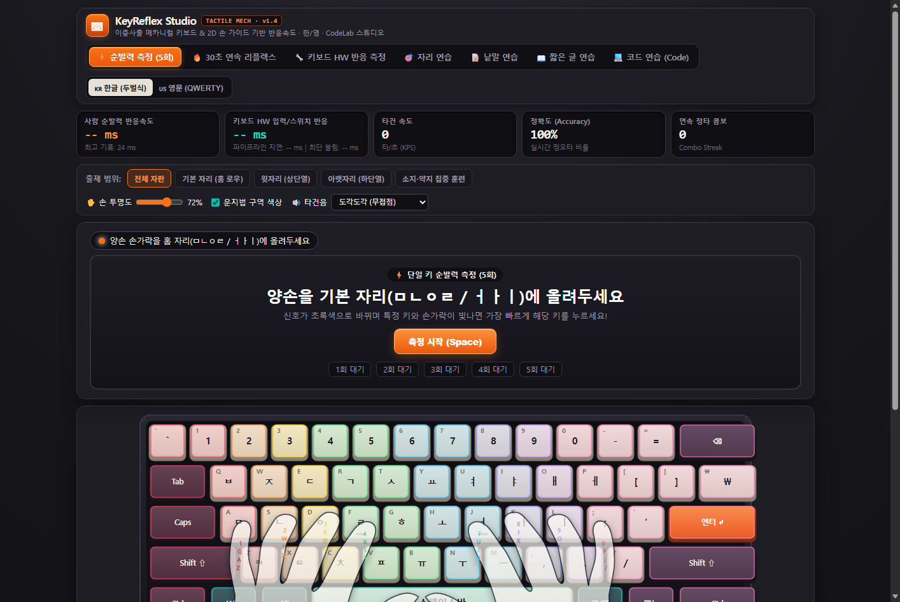
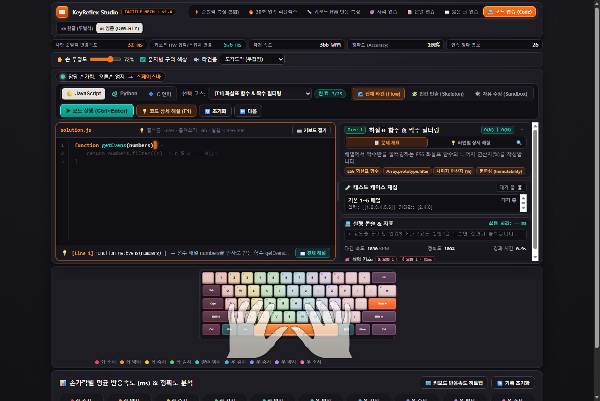
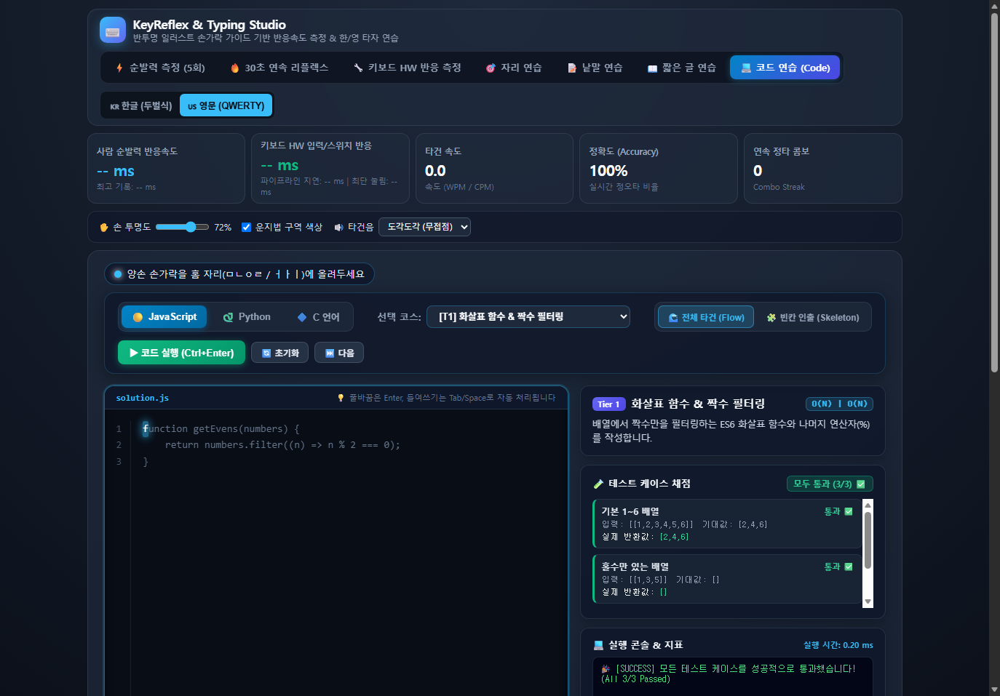
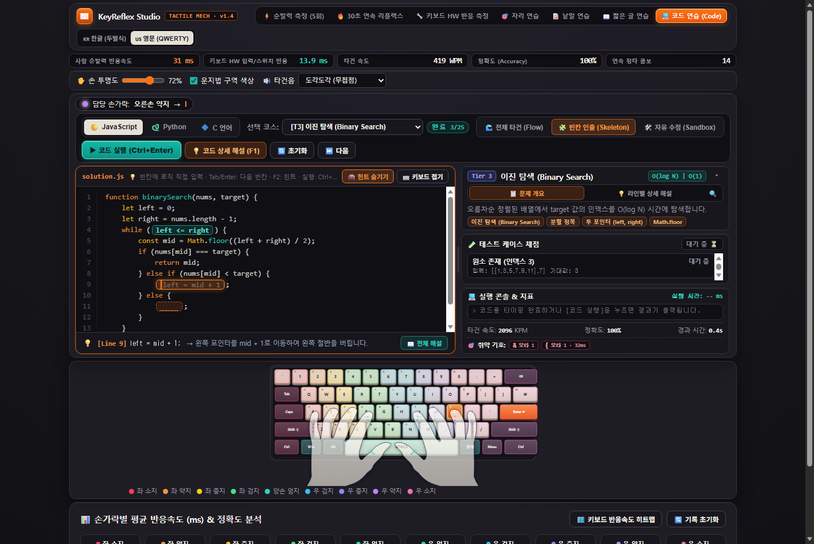
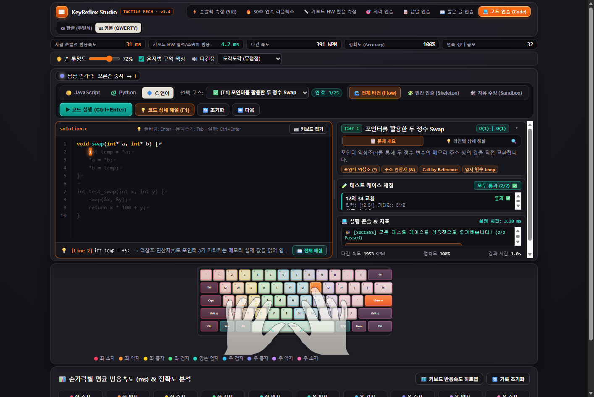
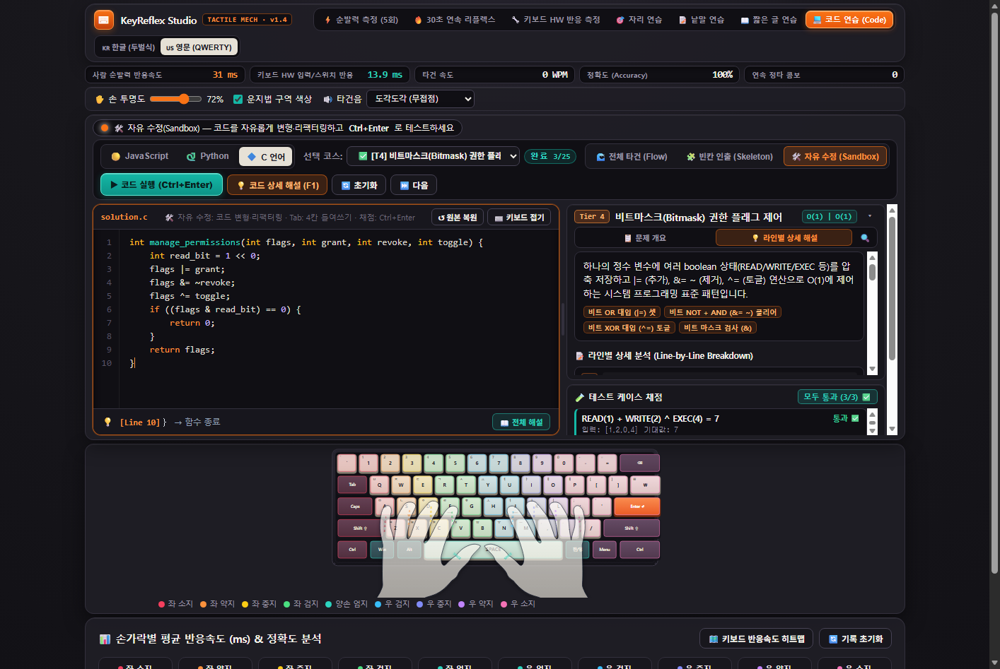
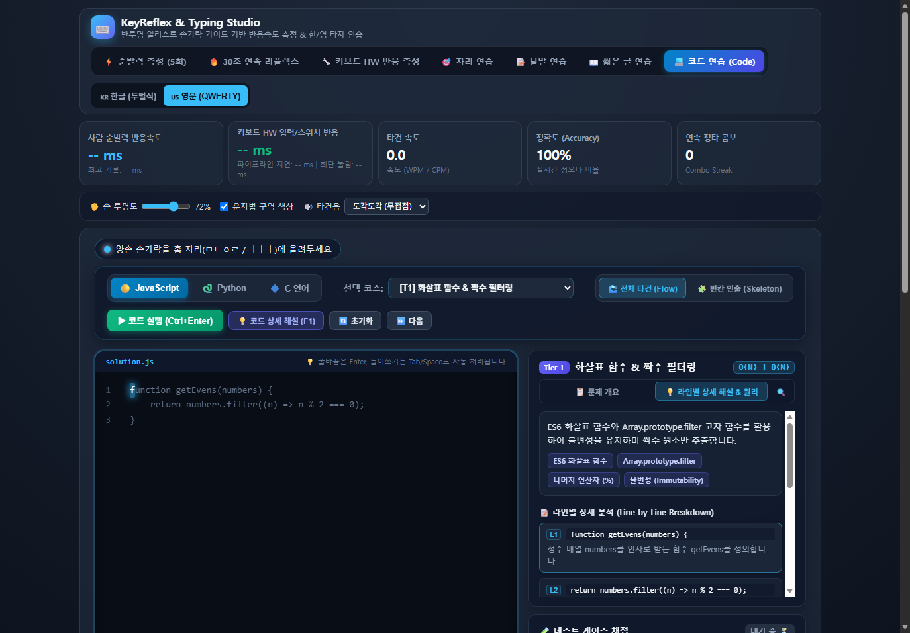
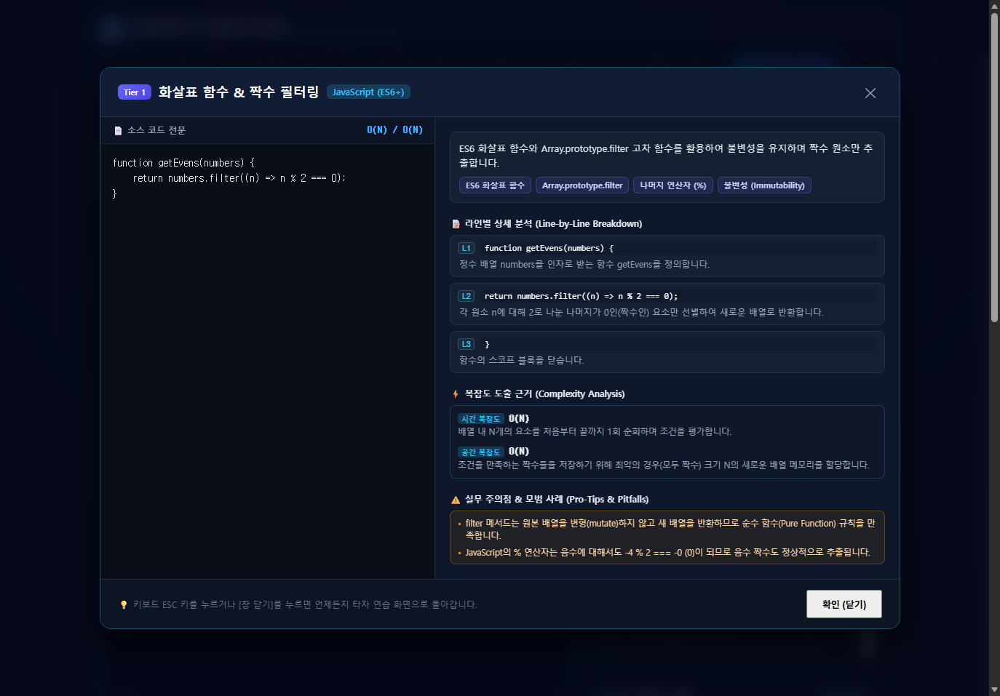

## ⌨️ KeyReflex Studio v1.4.0 — Tactile Mech Studio (Option B) UI/UX 전면 개편 & CodeLab Tri-Engine 통합 릴리즈

이번 **`v1.4.0`** 릴리즈에서는 커스텀 기계식 키보드 감성의 **Tactile Mech Studio (Option B) 전면 디자인 개편**과 **5대 UX/레이아웃 업그레이드**, 그리고 **25개 균형 커리큘럼·자유 수정(Sandbox)·C99 비트마스크/포인터 VM·갈축/적축 타건음·취약 기호 분석**이 모두 통합되었습니다!

> **핵심 요약**: 웜 매트 스튜디오 섀시(`#151419`), **3D 이중사출(Double-Shot) PBT 키캡**, **리세스드 OLED 계기판**, **전 모드 오프라인 구문 강조(Syntax Highlighting)**, **드래그 스플릿 리사이저**, **25문제 균형 4-Tier 커리큘럼(JS 8 · Python 9 · C 8)**을 단일 무설치 실행 파일(`KeyReflex-Studio.exe`)로 바로 실행할 수 있습니다.

---

### 📸 화면별 주요 변경점 & 상세 가이드 (Screenshot Walkthrough)

#### 1. ⌨️ Tactile Mech Studio 메인 스튜디오 & 3D 이중사출 PBT 키캡
- **아노다이징 알루미늄 섀시 & 3D PBT 키캡**: 리세스 스위치 플레이트, 4코너 육각 나사, 오프화이트(`#DEDAD0`) 알파열, 다크 차콜(`#3B3946`) 모디파이어, 엠버 오렌지(`#F97316`) `Enter` 액센트 키캡을 순수 SVG로 구현했습니다.
- **캐노니컬 2D 벡터 손 가이드 100% 보존**: 기존 인체공학 베지에 손 실루엣과 역운동학(IK) 뻗음 애니메이션의 비율·형태는 일절 왜곡 없이 그대로 유지했습니다.
- **리세스드 OLED 계기판 & 신규 타건음**: 순발력(ms), 하드웨어 접점/체공 지연(ms), WPM/KPS, 정확도, 콤보를 OLED 계기판으로 표시하며 **갈축(Tactile)** · **적축(Linear)** 합성음 프리셋을 추가했습니다.

---

#### 2. 🌊 CodeLab `Flow` 모드 — 오프라인 시맨틱 구문 강조 & 슬림 1-Line OLED 바
- **1-Line 슬림 OLED 계기판**: CodeLab 진입 시 상단 계기판을 한 줄로 슬림화하여 **에디터·해설 높이를 확장하면서도 하단 키보드·손 가이드가 한 화면 안에 온전히 들어오도록** 최적화했습니다.
- **오프라인 시맨틱 구문 강조 (`tok-kw`, `tok-fn`, `tok-str`, `tok-type`, `tok-num`, `tok-op`)**: 외부 CDN 없이 자체 토크나이저로 키워드·함수·문자열·타입·연산자를 색상 구분합니다. 미타건 영역은 `0.50` 반투명으로 유지하고 타이핑이 끝난 글자는 `1.0` 고대비로 점등되어 가독성과 진행 감각을 동시에 높였습니다.
- **드래그 스플릿 리사이저 (`⋮`)**: 에디터와 우측 패널 비율(`42%`~`74%`)을 마우스로 드래그 조절(`localStorage` 저장)하며 **더블클릭 시 58%로 즉시 초기화**됩니다.

---

#### 3. 🐍 Python 3 (Pyodide WASM) & `Pyodide 준비됨` 상태 배지
- **4-Tier 균형 커리큘럼 (Python 9문제 포함 총 25문제)**: `collections.deque` 슬라이딩/회전, 스택 괄호 검사, 이진 탐색, 해시 투 썸, DP 피보나치, `@memoize` 클로저, 슬라이딩 윈도우 API Rate Limiter까지 Tier 1~4 전 구간을 균형 있게 수록했습니다.
- **실시간 런타임 상태 배지**: Python 선택 시에만 우측 상단에 **`Pyodide 준비됨 / 로딩 중`** 상태 배지를 표시하며, `print()` 표준 출력까지 콘솔에 캡처합니다.

---

#### 4. 🧩 `Skeleton` 빈칸 인출 모드 (`F2` 고스트 힌트 & 4-Tier 컬러 위계)
- **핵심 로직 기억 인출 훈련**: 조건식·포인터 연산 등 알고리즘의 핵심 구간(`____`)을 직접 채워 넣으며 `Tab`/`Enter`로 다음 빈칸으로 빠르게 점프할 수 있습니다.
- **`F2` 고스트 힌트 토글 & 빈칸 보호**: 정답 힌트가 필요할 때 `F2`로 힌트를 확인하거나 숨길 수 있으며, 미완성 빈칸 실행 시 명확한 안내 메시지를 출력합니다.
- **4-Tier 컬러 위계**: Tier 1(Teal `#14B8A6`) · Tier 2(Blue `#3B82F6`) · Tier 3(Purple `#A855F7`) · Tier 4(Amber `#F97316`)로 문제 난이도를 직관적으로 구분합니다.

---

#### 5. 🔷 C99 포인터 가상머신 & 🛠️ `Sandbox` 자유 수정 모드 (실시간 백드롭 하이라이팅)
- **확장된 C99 브라우저 VM**: 별도 컴파일러 없이 포인터 역참조(`*a = *b`), 배열 순회, 문자열 길이/역순, **비트마스크/시프트(`<<`, `>>`, `&`, `|`, `^`, `~`, `|=`, `&=`, `^=`)**, 원형 버퍼(Ring Buffer)까지 실행하고 자동 채점합니다.
- **`Sandbox` 자유 수정 & 실시간 구문 강조**: 코드 편집용 `<textarea>` 뒤에 스크롤 동기화된 `<pre>` 백드롭을 겹쳐 **직접 수정하는 중에도 실시간 구문 강조**가 유지됩니다. `Tab`/`Shift+Tab` 4칸 들여쓰기 및 **`원본 복원`** 버튼을 지원합니다.
- **🎯 취약 코딩 기호 TOP 5 추적**: 자주 틀리거나 입력이 느린 코딩 기호(`{ } [ ] ; = & |`)를 실시간 집계해 우측 하단 콘솔 영역에 표시합니다.

| 🔷 C99 포인터 실행 & 자동 채점 | 🛠️ Sandbox 자유 수정 & C99 비트마스크 |
| :---: | :---: |
|  |  |

---

#### 6. 💡 라인별 상세 해설 패널 (`▾` 접기 토글) & `F1` 전체 해설 모달
- **우측 패널 동시 가시성**: `문제 개요 / 라인별 해설`, `테스트 케이스 채점`, `실행 콘솔 & 취약 기호`를 한 화면에서 동시에 확인하며 우측 상단 **`▾` 버튼**으로 설명 영역을 자유롭게 접고 펼 수 있습니다.
- **전체 화면 해설 모달 (`F1` / `ESC`)**: 소스 코드 전문(시맨틱 컬러 적용), 줄별 상세 분석(`L1`..`Ln`), 시간/공간 복잡도 도출 근거, 실무 주의점을 큰 화면에서 정독하고 즉시 복귀할 수 있습니다.

| 💡 라인별 상세 해설 탭 & 패널 구성 | 📖 F1 전체 화면 해설 모달 |
| :---: | :---: |
|  |  |

---

### ✅ 자동화 품질 검증 & 실행 파일
- **Edge CDP 통합 자동 검증**: **188개 항목 PASS / 0개 FAIL** (런타임·콘솔 에러 `0`, JS/Python Pyodide WASM/C99 VM 전 25문제 정답 통과 및 변이 코드 실패 검증, UI/레이아웃/키보드 뷰포트 검사 포함)
- **📥 다운로드**: 아래 Assets에서 **`KeyReflex-Studio.exe`**를 내려받아 더블 클릭하면 별도 설치나 런타임 없이 독립 데스크톱 창 모드로 즉시 실행됩니다.
