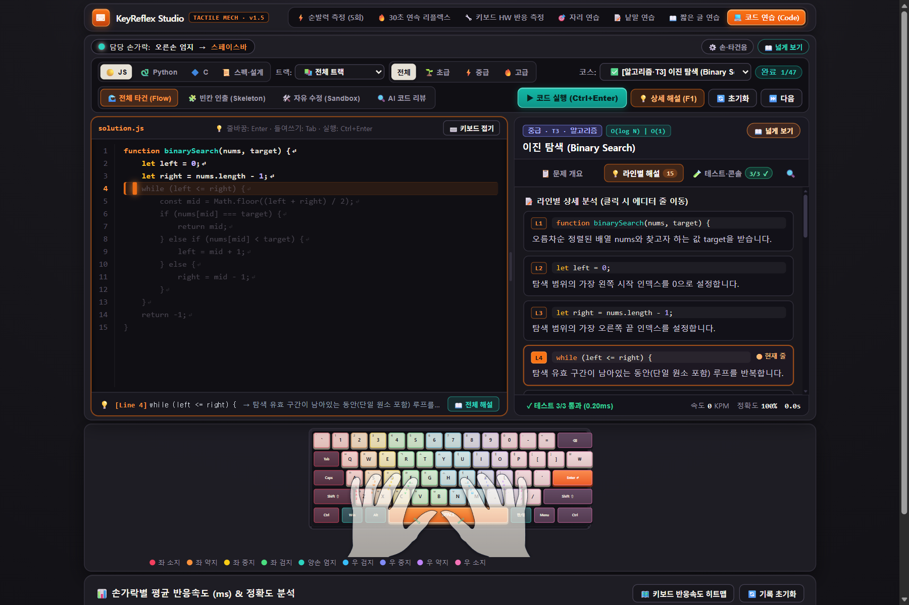
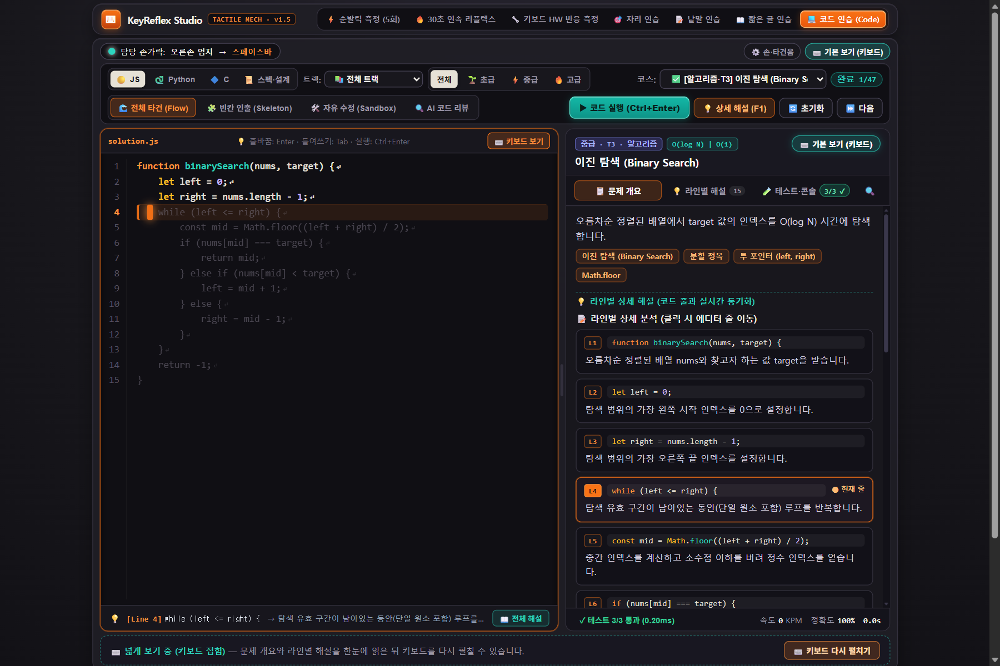
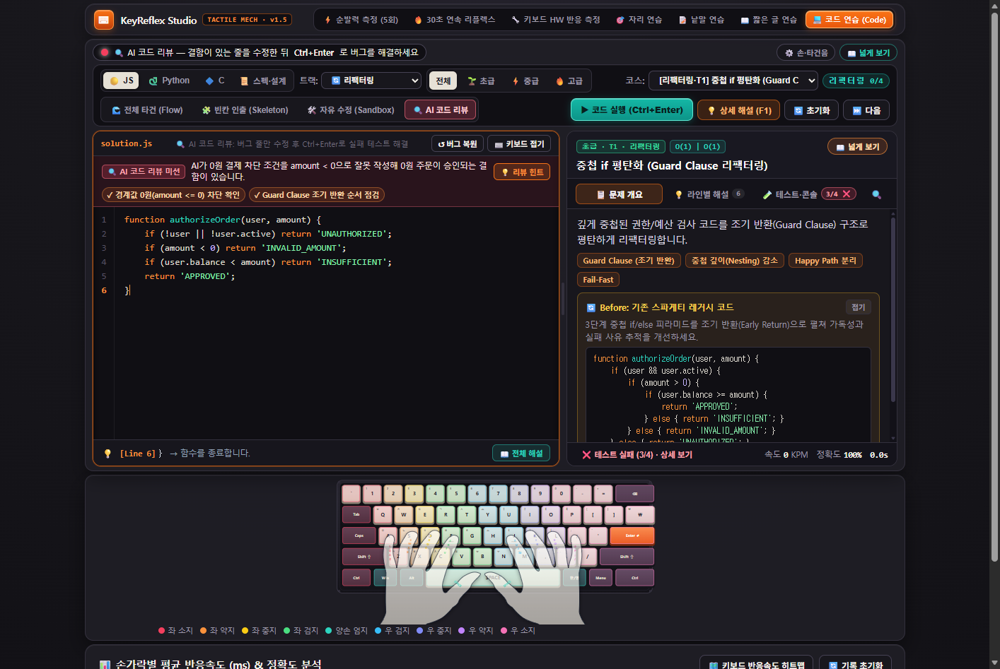
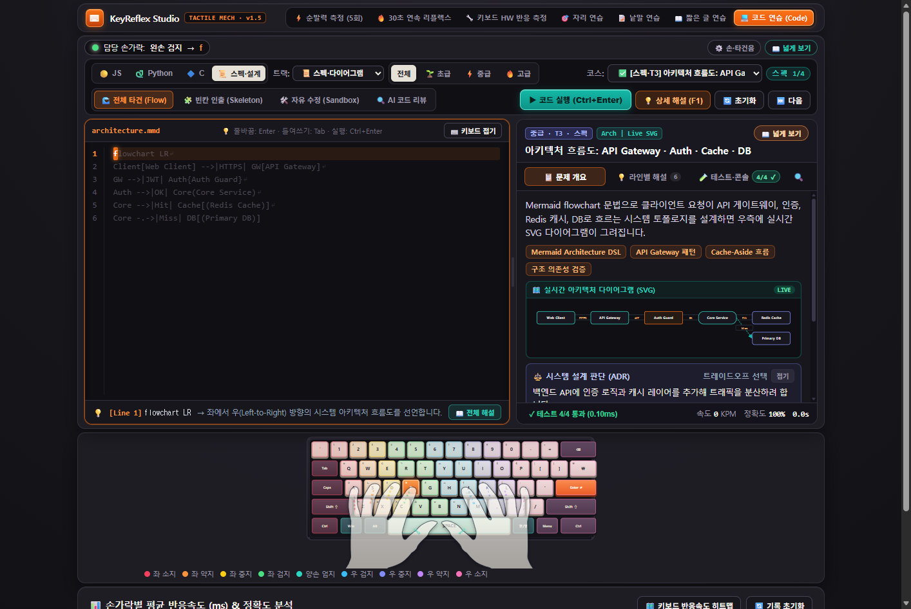

## 🌐 KeyReflex Studio v1.5.0 — CodeLab 하이브리드 UX · AI 시대 6대 트랙(47레슨) · 공식 웹 배포

이번 **`v1.5.0`** 릴리즈에서는 **GitHub Pages 공식 웹 버전** 오픈과 함께, **CodeLab 하이브리드 UI/UX ("Studio Pro")**, **AI 시대 6대 엔지니어링 트랙 · 초/중/고급 난이도 필터 · 47개 커리큘럼**, 그리고 **2D 손가락 IK 왜곡 수정**을 모두 통합했습니다!

- 🌐 **웹에서 바로 실행하기**: **[https://manofkimchi08.github.io/keyreflex-studio/](https://manofkimchi08.github.io/keyreflex-studio/)** (설치 불필요 · 최신 브라우저 즉시 실행)
- 💻 **Windows 무설치 앱**: 아래 Assets에서 [`KeyReflex-Studio.exe`](https://github.com/ManofKimchi08/keyreflex-studio/releases/download/v1.5.0/KeyReflex-Studio.exe) 다운로드

---

### ✨ 주요 하이라이트

#### 1. ⚡ CodeLab 하이브리드 UX ("Studio Pro" — 3중 스크롤 제거 & 2.1× 풀높이 전환)
- **우측 단일 통합 3-탭 (`📋 문제 개요` · `💡 라인별 해설` · `🧪 테스트·콘솔`)**: 3단 카드 적층과 3중 흰색 스크롤바를 완전히 제거하고, 우측 하단 고정 1줄 상태바에서 테스트 통과·KPM·정확도를 상시 확인합니다.
- **상단 슬림화 + `⚙️ 손·타건음` 팝오버 토글**: 코드 연습 중 불필요한 글로벌 HUD를 접어 기본 타건 상태의 작업 높이를 **+41%(475px)** 확장했습니다.
- **`📖 넓게 보기` (키보드 도킹 · 725px 풀높이 확장)**: 키보드를 하단 1줄 도킹 바로 접고 `문제 개요`와 `라인별 상세 해설`을 동시에 조망합니다.
- **에디터 ↔ 해설 양방향 동기화 & 코드 합자 비활성화**: 작성 중인 줄(`L#`)이 좌우에 동시 강조되며 해설 카드를 호버·클릭하면 에디터 해당 줄로 이동합니다. `<=`, `===` 기호는 합자 없이 원형 그대로 표시됩니다.

| ⚡ 상태 1 · 단일 통합 탭 (키보드 ON · 475px) | 📖 상태 2 · 넓게 보기 (2.1× 풀높이 · 725px) |
| :---: | :---: |
|  |  |

---

#### 2. 🤖 AI 시대 6대 실무 트랙 · 난이도 필터 · 47개 커리큘럼
단순 문법 타자를 넘어 설계·리팩터링·AI 코드 리뷰·아키텍처 스펙까지 훈련할 수 있도록 **47개 레슨**(`JS 17 · Python 15 · C 11 · 📜 스펙·설계 4`)을 구축했습니다.
- **6개 트랙**: `📐 알고리즘(22)` · `🏗️ 설계·아키텍처(7)` · `🔄 리팩터링(4)` · `🤖 AI·RAG 인프라(5)` · `⚖️ 시스템 설계·ADR(5)` · `📜 스펙·다이어그램(4)`
- **초/중/고급 난이도 필터**: `전체` · `🌱 초급` · `⚡ 중급` · `🔥 고급`
- **`🔍 AI 코드 리뷰 (Audit)` 모드**: AI가 만든 결함 코드에서 버그가 숨어 있는 줄만 최소 타건으로 수정해 실패 테스트를 통과시키는 디버깅 훈련
- **실무 설계 카드**: `🗺️ 실시간 Mermaid → SVG 아키텍처 다이어그램`, `⚖️ 시스템 설계 판단 (ADR)`, `🔄 Before 레거시 코드 비교`(접기/펼치기 지원)

| 🔍 AI 코드 리뷰 (`Audit`) & `Before` 비교 | 📜 스펙·아키텍처 실시간 `SVG` 다이어그램 & `ADR` |
| :---: | :---: |
|  |  |

---

#### 3. 🖐️ 2D 벡터 손가락 IK 왜곡 수정 (`handRenderer.js?v=12.0`)
- 외곽 키(`Shift` + `[`, `` ` `` 등) 도달 시 소지·손가락이 비정상적으로 꺾이던 S-루프 왜곡을 축방향 제어점 가중치 보간으로 해결했습니다.

---

### ✅ 자동화 품질 검증 요약
- **하이브리드 UX E2E 검증 (`verify_codelab_hybrid_ux.py`)**: **11/11 PASS** (콘솔 에러 `0`, 3중 스크롤 제거, 양방향 동기화, Sandbox 폰트 정렬, 2.1× 확장 검증)
- **v1.5.0 전체 커리큘럼 E2E 검증 (`verify_ai_era_v150.py`)**: **13/13 PASS** (4개 언어 `47`개 레슨 정답 통과 · AI 버그 코드 실패 검증 · Pyodide WASM & C99 VM 정상 동작)
