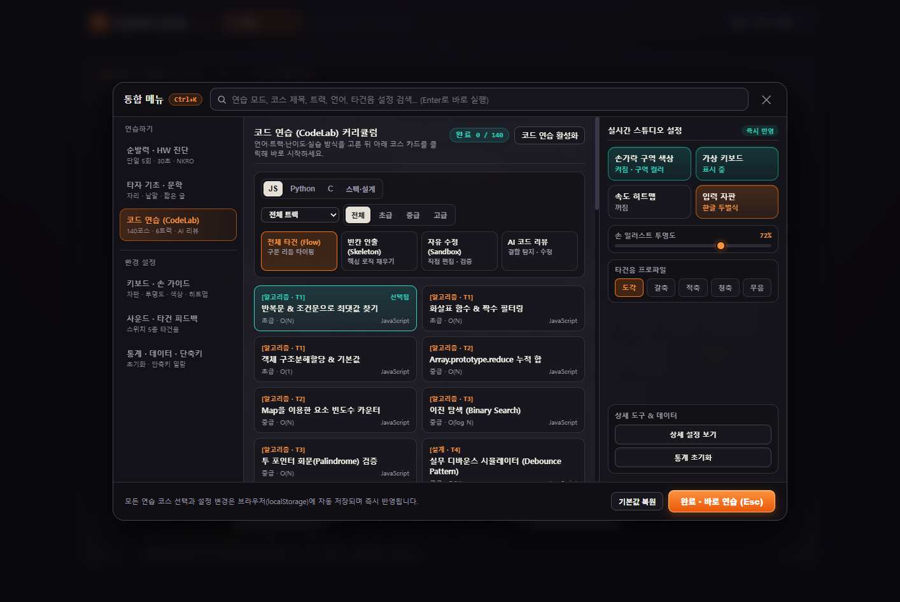
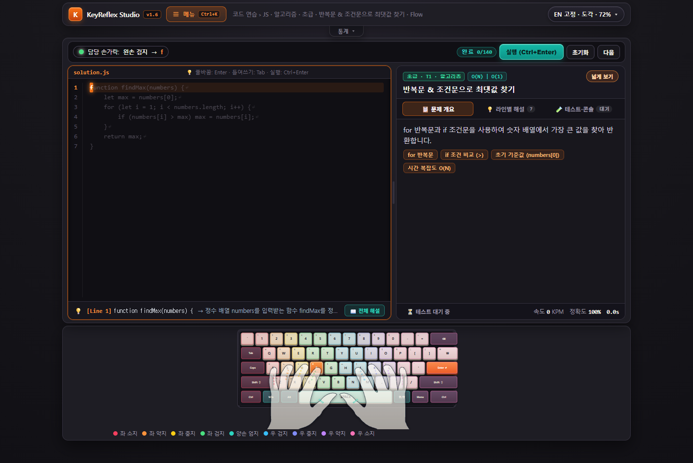
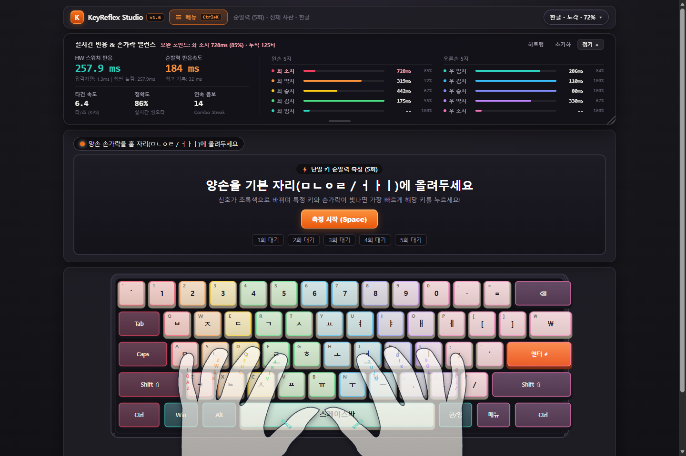
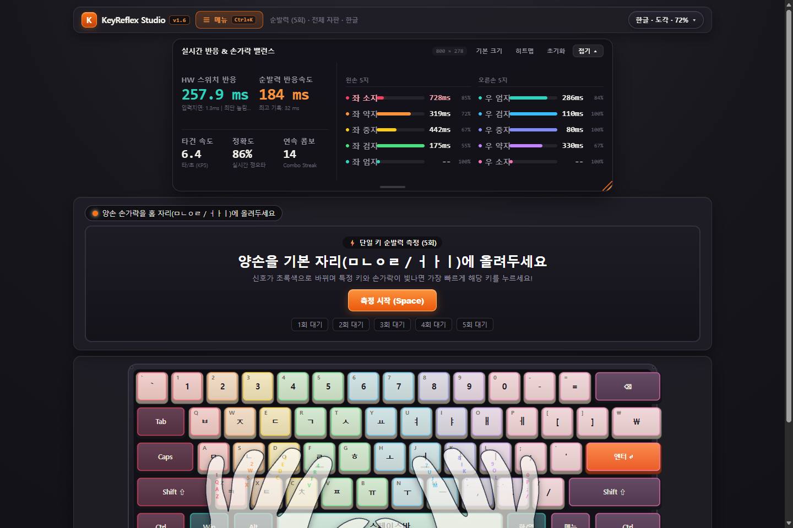

## 🌐 KeyReflex Studio v1.6.0 — 140코스 CodeLab 대규모 확장 · 상단 리사이즈 텔레메트리 · 통합 메뉴

이번 **`v1.6.0`** 릴리즈에서는 CodeLab 커리큘럼을 **`47 → 140레슨`**으로 대폭 확장하고 전 문항 런타임·스켈레톤·라인해설·결함 테스트를 100% 전수 검수했으며, 분리되어 있던 계기판을 **상단 접이식·자유 리사이즈 통합 텔레메트리 시트(`Ctrl+I`)**와 **통합 메뉴(`Ctrl+K`)**로 전면 재정비했습니다.

- 🌐 **웹에서 바로 실행하기**: **[https://manofkimchi08.github.io/keyreflex-studio/](https://manofkimchi08.github.io/keyreflex-studio/)** (설치 불필요 · 최신 브라우저 즉시 실행)
- 💻 **Windows 무설치 앱**: 아래 Assets에서 [`KeyReflex-Studio.exe`](https://github.com/ManofKimchi08/keyreflex-studio/releases/download/v1.6.0/KeyReflex-Studio.exe) 다운로드 (`v1.6.0` 리소스 번들)

---

### ✨ 주요 하이라이트

#### 1. 📚 CodeLab 140코스 대규모 확장 & 전수 런타임 검수 (`47 → 140레슨`)
저작권 걱정 없는 100% 자체 제작 신규 3대 모듈 팩(**초급** [`curriculumBeginnerPack.js`](https://github.com/ManofKimchi08/keyreflex-studio/blob/v1.6.0/js/curriculumBeginnerPack.js) `+30` · **중급** [`curriculumIntermediatePack.js`](https://github.com/ManofKimchi08/keyreflex-studio/blob/v1.6.0/js/curriculumIntermediatePack.js) `+22` · **고급** [`curriculumAdvancedPack.js`](https://github.com/ManofKimchi08/keyreflex-studio/blob/v1.6.0/js/curriculumAdvancedPack.js) `+24`)과 기존 64개 레슨 균형화·정밀 검수를 통합해 총 **140개 실무형 문제**를 탑재했습니다.

- **언어별 분포 (140)**: `JavaScript 46` · `Python 42` · `C99 34` · `Spec/DSL 18`
- **난이도별 분포 (140)**: `초급 49` · `중급 53` · `고급 38`
- **6대 트랙별 분포 (140)**: `알고리즘 60` · `아키텍처 15` · `시스템 설계 15` · `리팩토링 15` · `AI 엔지니어링 17` · `스펙·다이어그램 18`
- **전수 정밀 검수 및 결함 수정**: `js_debounce_pattern`, `js_circuit_breaker`, `py_mid_circuit_breaker` 상태 전이/엣지 결함 및 복잡도 배지 불일치를 교정하고, 전 **140/140** 문항에 대해 스켈레톤 무손실 복원, 비공백 전 줄 `lineByLine` 해설, `ADR` 선택지, `Audit` 버그 코드 의도적 실패, 숨겨진 엣지 케이스까지 모두 통과시켰습니다.

| 📋 140코스 통합 CodeLab 메뉴 | 💻 v1.6 클린 CodeLab 스튜디오 |
| :---: | :---: |
|  |  |

---

#### 2. 📊 상단 접이식 · 자유 리사이즈 통합 텔레메트리 시트 (`Ctrl+I`)
기존에 상단 메트릭 바와 하단 10손가락 분석으로 나뉘어 시선을 분산시키던 계기판을 **상단 1개 통합 시트**로 합쳤습니다.

- **기본 접힘 풀탭 (`통계 ▾`)**: 평상시에는 상단 헤더 아래 슬림 풀탭으로 접혀 있어 키보드와 에디터 뷰포트를 넉넉하게 확보합니다.
- **대칭 2-Hand 10지 슬림 바 + 취약 손가락 자동 강조**: 왼손/오른손 5지씩 대칭 막대로 반응속도(ms)와 정확도(%)를 보여주고, 가장 느린 손가락을 `보완 포인트` 태그로 강조합니다.
- **5대 KPI + 히트맵 원클릭 토글**: `사람 순발력`, `HW 스위치 반응`, `타건 속도(KPS)`, `정확도`, `연속 콤보`를 상단 시트 안에서 실시간 확인하며 히트맵 토글·초기화를 바로 실행합니다.
- **드래그 자유 리사이즈 & 더블클릭 초기화**: 하단·우측·코너 핸들을 드래그해 원하는 폭/높이로 조절(더블클릭 시 기본 크기 복원)하며 열림 상태와 크기는 `localStorage`에 영구 저장됩니다.

| 📈 상단 텔레메트리 시트 펼침 (`Ctrl+I`) | 📐 드래그 리사이즈 & 콤팩트 레이아웃 |
| :---: | :---: |
|  |  |

---

#### 3. 🎛️ 통합 메뉴 (`Ctrl+K`) & 상단 네비게이션 정리
- **중복 메뉴 버튼 정리**: 상단 이동 진입점을 좌측 `메뉴 (Ctrl+K)`와 우측 `빠른 설정 (Ctrl+,)` **2곳**으로 일원화하고, 현재 경로 브레드크럼을 클릭 불가 읽기 전용 라벨로 정돈했습니다.
- **이모지 없는 클린 타이포 & 용어 통일**: 메뉴·상단바·텔레메트리·코스 제목에서 이모지를 전면 제거하고, `운지법` 표현을 직관적인 `손가락 구역`으로 통일했습니다.
- **실시간 통합 검색 & 3-Way 설정 동기화**: `Ctrl+K` 한 번으로 모드·140코스 제목·트랙·언어·언어/트랙/난이도 필터링 및 우측 스튜디오 설정 도크(`Hub/Dock/Popover` 3-Way 동기화)를 즉시 조작합니다.

---

### ✅ 자동화 품질 검증 요약 (`v1.6.0`)
- **`audit_all_140_lessons.py`**: **140/140 전수 PASS** (`total_failures: 0` · JS 46 / Python Pyodide 42 / C99 VM 34 / SpecEngine 18 정답·Audit 버그 실패·스켈레톤·라인해설·복잡도·숨겨진 엣지 케이스 검증)
- **`verify_ai_era_v150.py`**: **ALL PASS** (`total_failures: 0` · 140코스 전환, SVG 다이어그램, ADR, Before 비교, AI Audit 모드 및 뷰포트 검증)
- **`verify_unified_bc_menu.py`**: **ALL PASS** (`total_failures: 0` · `Ctrl+K` 통합 메뉴 포커스, 실시간 검색/필터링, `Ctrl+,` 3-Way 설정 동기화, 영구 저장)
- **`verify_telemetry_panel.py`**: **ALL PASS** (`total_failures: 0` · `Ctrl+I` 상단 시트 토글, 10지 대칭 바, 드래그 리사이즈, 더블클릭 초기화, 0 콘솔 에러)
